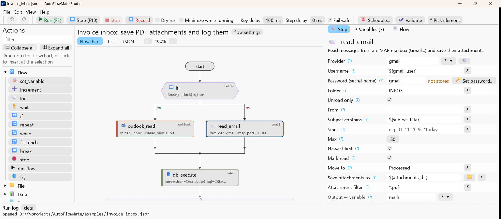
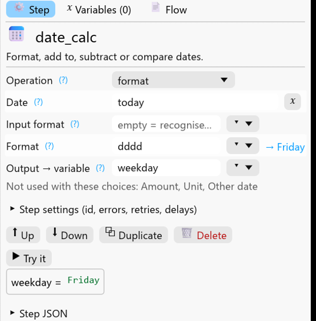
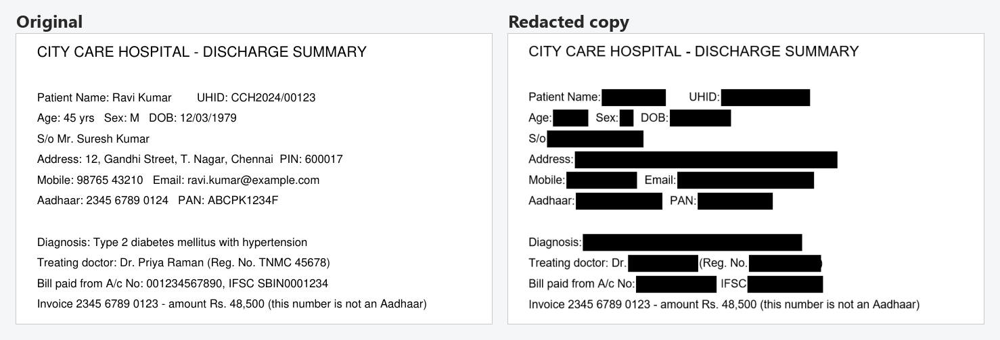
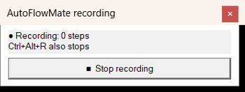
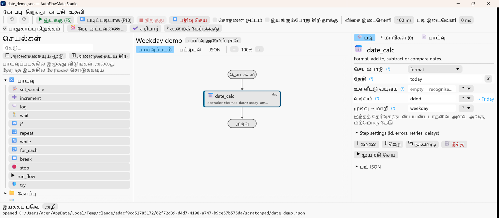

<p align="center">
  <picture>
    <source media="(prefers-color-scheme: dark)" srcset="assets/wordmark-dark.png">
    
  </picture>
</p>
<p align="center"><b>RPA for a more productive you.</b> Automate your flow, with a friendly mate.</p>

<p align="center">
  <a href="https://github.com/SRathinaGiri/AutoFlowMate/releases/latest"><b>⬇ Download for Windows</b></a> ·
  <a href="#examples-to-start-from">Examples</a> ·
  <a href="docs/GUIDE.md">Full guide</a> ·
  <a href="#for-developers">For developers</a>
</p>

<p align="center"></p>

**AutoFlowMate** is a free desktop app for **Windows PCs** that does your boring, repetitive
computer work for you. Show it the steps once (copy these files, open that program, type this,
click there, read that invoice, send this mail) and it repeats them whenever you like, as often
as you like, without mistakes.

It is a Windows desktop tool only: it runs on your own PC, works with the programs you already
use, and needs no server, no cloud account and no subscription. It is open source under the MIT
licence: anyone may use it, change it and share it, free of charge, without warranty.

> The name has two meanings: it **auto**mates your **flow**, and it is your friendly **AutoFlow mate**.

## Who is it for?

AutoFlowMate sits between big, expensive enterprise automation suites and do-it-yourself
scripting. It is free, it is one portable folder, and it needs nothing else installed: no Python,
no server, no licence fees.

- **Accounting, finance and back-office teams** in small firms and practices: Tally exports, Excel
  and CSV registers, invoice tables taken from PDFs, GST calculations and portal look-ups (you type
  the CAPTCHA), payment letters filled in Word, and mails with the results.
- **Everyday office users** who want the boring part of their day done for them: build a flow by
  dragging boxes in a flowchart, or just record what you do. Studio speaks your language (Tamil is
  included).
- **IT and Windows administrators:** schedule flows with Windows Task Scheduler, react to files
  and mails as they arrive, talk to databases, and keep passwords in the Windows Credential
  Manager. Every command can report in JSON for monitoring scripts.
- **People who work with AI assistants:** flows are plain JSON with a strict schema and a dry-run
  mode, so an assistant can write, check and run desktop automations safely.

---

## What it looks like

<p align="center"></p>

**AutoFlowMate Studio** shows your automation as a **flowchart**. Pick an action from the list on
the left (104 of them, in 22 groups), drop it into the chart, and fill in its details on
the right. Press **▶ Run** and watch it work.

## What you can automate

| Area | For example |
|---|---|
| 📁 **Files and folders** | Sort downloads into folders, rename and move files, clean up old files, zip and unzip |
| 📊 **Excel, CSV and PDF** | Read a list of customers from Excel, take a table out of a PDF invoice, write a report to Excel or CSV |
| 📄 **Word documents** | Fill a letter template with names and amounts, write a report with a table |
| ✉ **E-mail** | Send mails with attachments through Outlook or Gmail, read your inbox and save the attachments |
| 🌐 **Web pages** | Open a site, fill in a form, click buttons, read the result, save a picture of the page |
| 🖥 **Any Windows program** | Click buttons and menus, type text, use keyboard shortcuts in Tally, Excel, Notepad or your own software |
| 🔎 **Reading the screen** | Find a picture on screen and click it, read text on screen (OCR) |
| 🗄 **Databases** | Save records in a built-in database, or read and write SQL Server, MySQL, Access or Tally through ODBC |
| 🔒 **Personal data (DPDP)** | Black out PAN, Aadhaar, mobile numbers, names, dates of birth and patient details in thousands of documents; swap account numbers for tokens you can turn back later |
| 🤖 **AI** | Ask an AI model (a local one, or OpenAI, Gemini, Claude) to classify comments, summarise text or pull out details |
| 🧮 **Text, dates and sums** | Work out a due date, get the weekday, add GST, round amounts, find an invoice number in text |
| 💬 **Asking you** | Show a message, ask a yes/no question, or ask you to type something (a CAPTCHA, for example) |

## Main features

### 🧩 Build without programming
Drag actions into the flowchart. Every field explains itself: hover over a field marked **(?)** to
see what it expects, the values it allows and an example. Choices are drop-down lists, fields that
don't apply are hidden, and **▶ Try it** shows what a text or date step will produce before you run
the whole flow.

<p align="center"></p>

### 🔒 Protect personal data (India's DPDP Act) · beta
Point **redact_files** at a single file or a folder of thousands of documents (pick types with
wildcards such as `*.pdf;*.docx`) and get redacted copies of the same type, offline and without AI. It finds PAN, Aadhaar (checked with the Aadhaar checksum, so other 12-digit numbers
are left alone), mobile numbers, e-mail, bank account numbers, IFSC, cards, UPI IDs, passport,
voter ID and driving licence numbers, and labelled details such as *Name:*, *DOB:*, *Sex:*,
*UHID:* and *Diagnosis:*. Add your own patterns (an employee code, a policy number) and lists of
names. Word and Excel files keep their formatting (pictures inside them are checked too); PDFs,
scans and pictures get solid black boxes, with no hidden text left behind. A report says what was
found in each file (counts only). It fails closed: a file that can't be checked completely (an
unreadable scan, for example) is never written, and the flow stops before anything is sent on.
It supports DPDP work rather than making a process compliant by itself: patterns and OCR can miss
things, so spot-check the results.

<p align="center"></p>

Need to share a table but keep the IDs? **pseudonymize** swaps account numbers, PAN or mobile
numbers for tokens such as `ACC-YQ9DMBP200WAXDWZ`. The same number always gets the same token, so
totals still add up, but nobody can work back to the number. The originals are kept encrypted in a
vault, and **depseudonymize** restores them for whoever holds the key. (Pseudonymised is not
anonymous: equal values stay equal and the other columns remain.)

### 📋 Start from a template
**File > New from template** offers ready-made flows: redact a folder, redact documents as they
arrive, pseudonymise and restore a table, Word letters from an Excel list, PDF invoices to an
Excel register, sort a folder by file type, zip and mail a backup. Save your own flows as
templates too (**File > Save as template**), so a colleague can reuse them.

### ⏺ Record, like a macro
Press **⏺ Record** and just do the job once. Your clicks and typing become steps you can edit
and replay. A small always-on-top window shows what has been recorded and has a **■ Stop**
button, and the mouse pointer changes while recording, so you always know it is on. Passwords
typed during recording are never saved.

<p align="center"></p>

### 🔤 Variables: one flow, many runs
Keep changing values (a file name, a customer, a date, an amount) in **variables** and write
`${customer}` wherever you need them. Loop over every row of an Excel sheet, every file in a
folder or every mail in the inbox. Ready-made values such as `${date}`, `${time}` and `${timestamp}` are
always available.

### ⏰ Schedules and triggers
Run a flow **every day at 9:00**, every Monday, at log-on, or every few minutes, using Windows'
own Task Scheduler, so nothing extra needs to keep running. Or let a flow start by itself
**when a file arrives in a folder** or **when a mail arrives**.

### 🧯 Safe by design
- **Stop at any time:** push the mouse into a screen corner or press **Ctrl+Alt+Q**.
- **Dry run** walks through a flow without clicking or typing anything.
- **Passwords never go into flows.** They are kept in the Windows Credential Manager.
- AutoFlowMate **never solves CAPTCHAs**; it shows them to you to type.
- E-mail through Outlook can open as a **draft for you to check** before it is sent.
- Steps can **retry**, **skip errors** or catch them with **try / catch**, and every run is logged.

### 🐞 Find problems easily
Set a **breakpoint** (F9) on a step, run **step by step** (F10) and see every variable's value at
each pause. Steps that failed are marked red in the flowchart.

### ⚙ Your settings, your language
Keep your AI services and mail servers in **File > Settings** once, and pick them from a list in
any flow. Choose the **text size** and **font** under **View**. The whole app can be
**translated**: Tamil is included, and adding a language is just one text file
(**View > Language**).

<p align="center"></p>

### 🤝 Works with AI assistants
Flows are simple text files (JSON), so an AI assistant such as Claude can write and fix them for
you. A ready-made skill teaches it how.

## Examples to start from

Open any of these from the `examples` folder in Studio. Those marked **offline** need nothing but
AutoFlowMate.

| Example | What it does |
|---|---|
| `file_organizer.json` | **Offline.** Creates sample files and sorts them into folders by type, then writes a report. |
| `documents_demo.json` | **Offline.** Takes the item table out of a PDF invoice, totals it, fills a Word letter, writes a Word report and zips them. |
| `gst_invoice_register.json` | **Offline.** Reads GSTINs from a PDF, makes an invoice for each with the GST split (CGST/SGST or IGST) and due date, saves them in a database and an Excel register. |
| `data_import_demo.json` | **Offline.** Reads a list from Excel, a table from CSV and the text of a PDF. |
| `calculator_uia.json` | Opens Windows Calculator, clicks the buttons to add two numbers and reads the answer. |
| `notepad_keyboard.json` | Types some lines in Notepad and saves the file through the Save As dialog. |
| `excel_sales_sheet.json` | Opens Excel, types a sales table with formulas, checks the total and saves it. |
| `web_form_demo.json` | Fills in a web form, submits it, checks the result and saves pictures of the page. |
| `gst_search.json` | For each GSTIN in an Excel sheet, searches the GST portal (you type the CAPTCHA) and saves the result page. |
| `invoice_inbox.json` | Reads unread mails about invoices, saves the PDF attachments, takes out the invoice number and amount, and logs them in a database and Excel. |
| `invoice_folder_watch.json` | Waits for PDF invoices to arrive in a folder and logs each one as it comes. |
| `classify_comments.json` | Asks an AI model to mark each customer comment as positive, negative or neutral, and saves the result to Excel. |
| `tally_balance_sheet_export.json` | Opens TallyPrime and exports the Balance Sheet. |
| `tally_export_and_mail.json` | Exports the Tally Balance Sheet and mails it (as an Outlook draft by default). |
| `redact_documents.json` | **Offline.** Redacts a folder of sample documents (text PDF, scanned PDF, Word, Excel, picture, text, CSV) full of made-up Indian personal data, with a report. |
| `pseudonymize_accounts.json` | **Offline.** Replaces account, PAN and mobile numbers in a customer list with tokens, then restores the originals from the encrypted vault. |
| `pyautogui_tour.json` | A tour of mouse movement, screenshots, pixel colours and finding a picture on screen. |

## Get started

1. Download the zip from the [Releases page](https://github.com/SRathinaGiri/AutoFlowMate/releases/latest)
   and unzip it anywhere (no installation needed).
2. Run **`autoflow-studio.exe`**.
3. Open `examples\file_organizer.json` and press **▶ Run (F5)**.
4. Make your own: **File > New**, drag in actions, save, run. Or press **⏺ Record**.

Needs Windows 10 or 11. A few actions need the program they automate (Excel, Outlook, Edge or
Chrome, TallyPrime).

The [full guide](docs/GUIDE.md) explains every feature in detail, and the
[action reference](skills/autoflowmate/references/actions.md) lists every action and its fields.

---

## For developers

<details open>
<summary><b>Technical overview</b></summary>

AutoFlowMate is written in **Rust** and is a Cargo workspace of three crates:

```
crates/autoflow-core   flow model, the 104 actions, engine, validation, recorder, triggers
crates/autoflow-cli    autoflow.exe: run / validate / schedule / watch / record / inspect ...
crates/autoflow-gui    autoflow-studio.exe: the visual editor (egui)
examples/              sample flows (validated by CI)
schema/                generated JSON Schema for flows
skills/autoflowmate/   AI agent skill + generated action reference
lang/                  Studio translations (ta.json, template.json)
docs/                  GUIDE.md (full user guide), ARCHITECTURE.md
```

- A **flow** is a JSON file: variables, settings, triggers and a list of steps. Each step is one
  action with its fields. The `actions!` macro in `crates/autoflow-core/src/actions/mod.rs` is
  the single list of actions; the JSON Schema, the action reference and Studio's forms are all
  generated from it.
- Built on enigo (mouse and keyboard), uiautomation (Windows UI Automation), egui/eframe, xcap,
  headless_chrome, calamine and rust_xlsxwriter, lettre/imap, rusqlite and odbc-api, ureq,
  fasteval and the `windows` crate (OCR, Credential Manager, hooks). Everything compiled into
  AutoFlowMate uses permissive licences, and CI enforces it with `deny.toml`. The one exception is
  headless_chrome's build-time code generator (`auto_generate_cdp`, GPL-3.0), which only runs
  while compiling and is not part of the programs.
- See [docs/ARCHITECTURE.md](docs/ARCHITECTURE.md) for the design.

</details>

<details>
<summary><b>Build from source</b></summary>

Requirements: Windows 10/11, Rust stable (MSVC) and the Visual Studio C++ build tools.

```powershell
cargo build --release
```

```powershell
cargo test --release --workspace
```

The programs are `target\release\autoflow.exe` (command line) and
`target\release\autoflow-studio.exe` (Studio). `scripts\package.ps1` builds the portable zip.

</details>

<details>
<summary><b>Command line</b></summary>

```powershell
autoflow run examples\calculator_uia.json --var a=9 --var b=4
```

```powershell
autoflow validate my_flow.json --json
```

```powershell
autoflow schedule add my_flow.json --when "daily 09:00"
```

Other commands: `record`, `watch`, `inspect`, `windows`, `mouse`, `locate`, `ocr`, `secret`,
`actions`, `template`, `schema`, `docs`, `new`. Every command has `--json` output. Details are in
the [full guide](docs/GUIDE.md).

</details>

<details>
<summary><b>AI agent skill</b></summary>

[skills/autoflowmate/SKILL.md](skills/autoflowmate/SKILL.md) teaches AI assistants to write,
explain, fix, validate and run flows. Without AutoFlowMate installed they still write the flow and
say it hasn't been validated.

- **Claude Code:** `/plugin marketplace add SRathinaGiri/AutoFlowMate`, then
  `/plugin install autoflowmate@autoflowmate`.
- **Antigravity CLI:** `agy plugin install https://github.com/SRathinaGiri/AutoFlowMate`.
- **Gemini CLI:** `gemini extensions install https://github.com/SRathinaGiri/AutoFlowMate`.
- **ChatGPT / Codex:** each release has an `autoflowmate-plugin-vX.Y.Z.zip` (portable Agent
  Plugins format; build it with `scripts\package-plugin.ps1`).
- **Other agents:** copy `skills\autoflowmate` into the agent's skills folder.

</details>

<details>
<summary><b>Contributing</b></summary>

Contributions are welcome: bug reports, ideas, translations, example flows and code. Please read
[CONTRIBUTING.md](CONTRIBUTING.md) first. In short:

1. **Fork** the repository and create a branch.
2. Make your change with tests, and run `cargo fmt`, `cargo clippy` and `cargo test`.
3. Open a **pull request** to `main` and fill in the checklist.
4. **CI** checks formatting, lints, build, tests, every example flow, the generated files and the
   licences of all dependencies. A pull request is merged only when CI passes and the maintainer
   has reviewed it.

Security problems: please report them privately as described in [SECURITY.md](SECURITY.md).

</details>

<details>
<summary><b>Releasing (maintainer)</b></summary>

1. Bump `version` in the workspace `Cargo.toml`, `gemini-extension.json`,
   `skills/autoflowmate/.claude-plugin/plugin.json` and `.antigravity-plugin/plugin.json` (the
   release workflow checks they match), and add `.github/release-notes/vX.Y.Z.md`.
2. Commit, then tag and push the tag (`git tag vX.Y.Z`, `git push origin vX.Y.Z`).
3. The **Release** workflow checks the tag matches `Cargo.toml`, runs the tests, builds the
   portable zip and the agent plugin zip, attests their build provenance and publishes the
   GitHub release with SHA-256 checksums.
4. winget: `scripts\winget-manifests.ps1 -Version X.Y.Z` writes and validates the manifests for a
   pull request to [microsoft/winget-pkgs](https://github.com/microsoft/winget-pkgs).

</details>

## Licence

MIT: free to use, change and share, including commercially, with no warranty. See [LICENSE](LICENSE).
